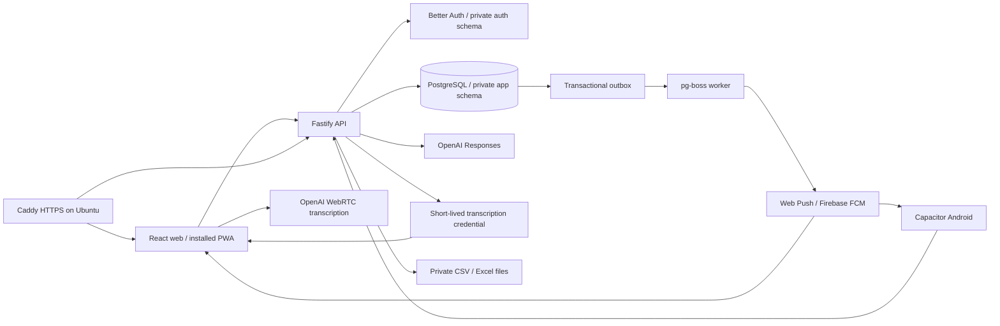

# Implemented architecture

The implementation is React 19 + TypeScript + Vite, TanStack Router/Query, Radix dialogs, ECharts, React Flow, and custom responsive CSS with Tailwind available. The network map is an explicitly labelled schematic using shipment coordinates, not a live vessel map. Design direction and the exact generated-image prompt are in `outputs/design/`.

Node 24/Fastify serves the application API. Better Auth stores users and sessions in `app_auth`. SQL migrations own the schema; repositories use parameterised `pg` SQL. Drizzle was considered in the initial plan; the current implementation uses a single SQL migration/repository path to avoid two schema sources of truth. Roles separate runtime, auth, migration, and queue access.

Every operational record has a tenant and demo-run scope. Composite foreign keys prevent references across runs/tenants. Runtime PostgreSQL row-level security requires transaction-local context. Memberships are read-only for the runtime role. Tenant advisory locks serialize decisions with reset; another tenant is independent. This coarse locking is suitable for the demonstration and should be replaced with measured, narrower locks before high-volume production ingestion.

Action proposals and approvals are separate persisted records. The payload hash and version bind the decision to reviewed details. Duplicate execution returns the existing result. Transfer approval rechecks available stock and reserves it; a later receipt event closes the stock case. Public signup and production quick-login are disabled. Real partner sending is not implemented/enabled.

OpenAI receives only the selected synthetic case context. Model tools read evidence or create drafts; they cannot send messages or approve a transfer. The browser never receives the long-lived API key. Microphone sessions receive a short-lived credential and send audio directly to OpenAI. Transcripts remain editable. API failure is labelled as a guided fallback.

Notifications use a transactional outbox, durable pg-boss queue, per-run deduplication, real-time expiry, encrypted device credentials, retry records, and distinct provider/client/acknowledgement events. A provider response does not prove delivery. Invalid tokens are deactivated. SSE refreshes authenticated web views; API data is not cached offline. Service-worker navigation can reopen the application shell offline, while operational actions still require connectivity.

Local PostgreSQL is native because Docker was absent on the development machine. On Ubuntu, Docker Compose/Caddy serve the web, API, and worker. Supabase can provide PostgreSQL over a direct or session-pooled connection. Supabase Auth/Edge Functions are not required. Third-party ERP/carrier/Hercules connectors are integration boundaries represented by synthetic source records in this demo, not deployed live integrations.
